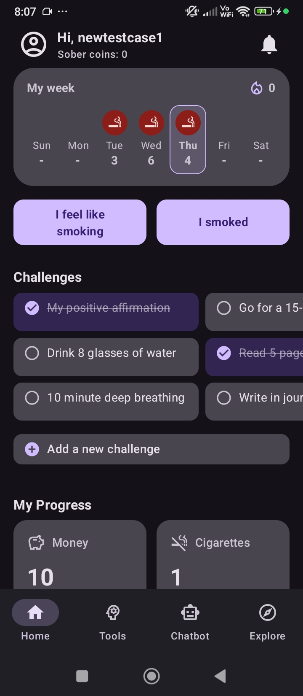
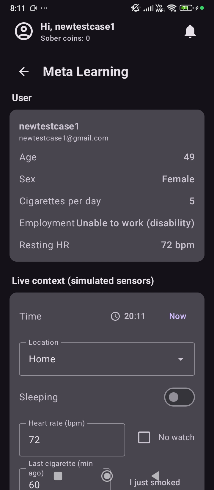
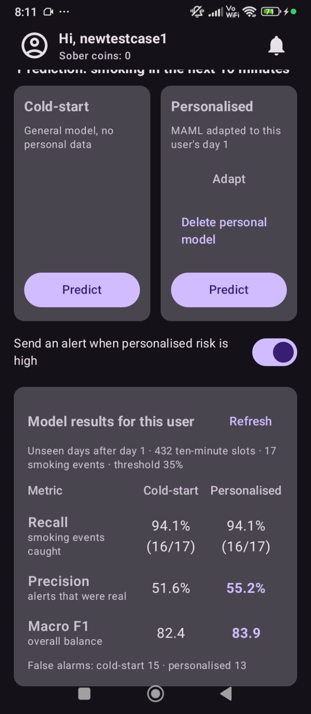
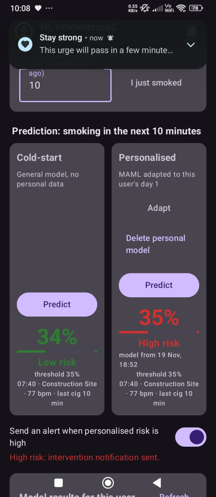
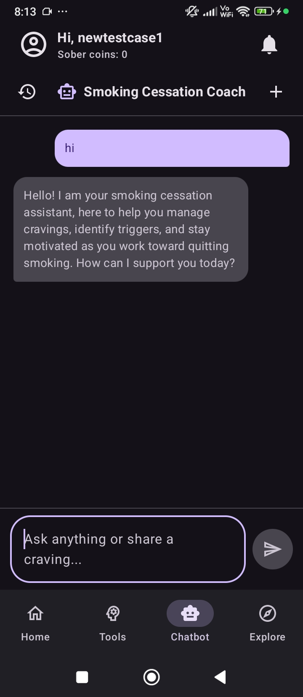

# Quit Assist: Craving Predictor

Final-year major project. The system predicts when a smoker is likely to have a craving in the next 10 minutes and steps in through an Android app before it happens.

It has three parts:

1. **Dataset generator**: builds realistic daily routines for 7,267 smokers.
2. **Meta-learning model**: learns from many users, then adapts to a new user from one day of their data.
3. **Android app**: collects live context (time, location, sleep, heart rate, last cigarette), shows the prediction, and adds voice craving detection and a support chatbot.

```
quit-assist-craving-predictor/
├── dataset-generator/   Synthetic routine + smoking dataset (Python)
├── meta-learning/       MAML / PLATIPUS / VAMPIRE / ABML / BMAML training, evaluation, prediction server
├── android-app/         Android app (Kotlin, Jetpack Compose) + voice server + chatbot server
├── results/             Training log and side-by-side results of all models
├── demo-testcases/      Test users used in the live demo, with their routines and sensor data
└── docs/screenshots/    Screenshots of the working app
```

---

## 1. Dataset generator (`dataset-generator/`)

Real minute-by-minute smoking data with heart rate and location is not publicly available, so we generate it.

- **Input:** 7,267 smokers from the NHIS survey (`dataset_prepro.csv`: age, sex, cigarettes per day, employment status).
- **Output:** 3 days × 144 ten-minute slots per person = **3,139,344 rows**.
- **Steps for each person:** persona → sleep → work/school → free-time activities → commute → smoking (based on location, time of day and time since last smoke, calibrated to the person's cigarettes per day) → time since last smoke → heart rate with sensor noise.
- About 9.6% of slots are followed by a cigarette.

Run:

```bash
cd dataset-generator
pip install -r requirements.txt
python generate_routine_general.py
```

The full output file (`dataset_prepro_routine_generated.csv`) is too large for GitHub. The command above recreates it. `Test_Sample_routine.csv` is a small sample of the output.

---

## 2. Meta-learning model (`meta-learning/`)

Each user is treated as a separate task:

- **Support set:** day 1 of the user (144 slots), used to adapt the model to that person.
- **Query set:** the remaining days, used to test it.
- **Input:** 31 features. **Target:** will the user smoke in the next 10 minutes.
- **Split:** 6,177 training users and 1,090 validation users, split by user.

We compared 5 algorithms (MAML, PLATIPUS, VAMPIRE, ABML, BMAML) on 2 networks (a small fully connected network, FcNet, and logistic regression).

**Final model: MAML + FcNet.** It uses first-order MAML, 5 inner steps, inner learning rate 0.01, focal loss and a decision threshold of 0.35. Settings are in `tabular/config.json`.

| MAML-FcNet | Result |
|---|---|
| Validation accuracy | 95.0% |
| Test Case 1, adapted: accuracy | 89.4% |
| Test Case 1, adapted: macro F1 | 76.0 |
| Test Case 1, adapted: smoking recall | 94% (32 of 34) |
| Test Case 1, without adaptation: macro F1 | 74.2 |

We chose it because it had the best macro F1 and is deterministic and fast (trains in about 3 minutes on CPU). Adapting to the user gives a consistent but modest improvement over the model without adaptation.

Main scripts:

```
tabular/scripts/Preprocessing.py                      build user tasks from the generated dataset
tabular/experiments/fcnet/train_maml_fcnet.py         train
tabular/experiments/fcnet/eval_maml_fcnet.py          evaluate with adaptation
tabular/experiments/no_adaptation/eval_cold_maml_fcnet.py   evaluate without adaptation
tabular/run_pipeline.py                               run all models in order
deploy/server.py                                      prediction API used by the app
```

**Prediction server** (`deploy/`, FastAPI, Docker):

- `POST /adapt` builds a personal model from the user's first day.
- `POST /predict_adapted` gives the craving probability for the current moment.
- `GET /health` is a health check.

---

## 3. Android app (`android-app/`)

Kotlin + Jetpack Compose, built from feature modules: `home`, `tools`, `chatbot`, `settings`, `login`, `metalearning`.

- **Home:** current risk and a weekly summary.
- **Meta Learning page:** adapts the model to the logged-in user and shows the prediction and the per-user metrics (recall, precision, F1, false alarms) with and without personalisation.
- **Sensors:** time, GPS location category, sleep state, an "I smoked" button (for time since last smoke), and heart rate from a smartwatch through Health Connect. The watch is optional; without it the server fills in a neutral heart rate.
- **Voice craving detection** (`core/voice/`): a foreground service listens for speech on the phone. The voice server converts speech to text with Whisper, filters negations ("I don't want a cigarette"), and compares the sentence with known craving phrases using a MiniLM sentence model. If it matches, the app sends an alert.
- **Chatbot** (`core/chatbot/`): FastAPI server using Gemini and Supabase. It remembers past conversations and the user's profile to give personal support.

Build the app:

```bash
cd android-app
./gradlew assembleDebug
```

The servers are deployed as Docker containers on Azure Container Apps. Each one needs its own keys set as environment variables; the `.env` file is not included in this repository. The voice model file (`model.onnx`) is also not included because of its size.

---

## Results and demo

- `results/` has the full training log and the comparison of all 10 model combinations.
- `demo-testcases/` has the two demo users, their routines, the sensor data loaded into the app, and `run_persona_eval.py` to check the numbers.
- `docs/screenshots/` has screenshots of the app running on a phone.

| Home | Meta Learning | Model results | Prediction + alert | Chatbot |
|---|---|---|---|---|
|  |  |  |  |  |

**Note:** all training data is synthetic. Results on real user data may differ.
